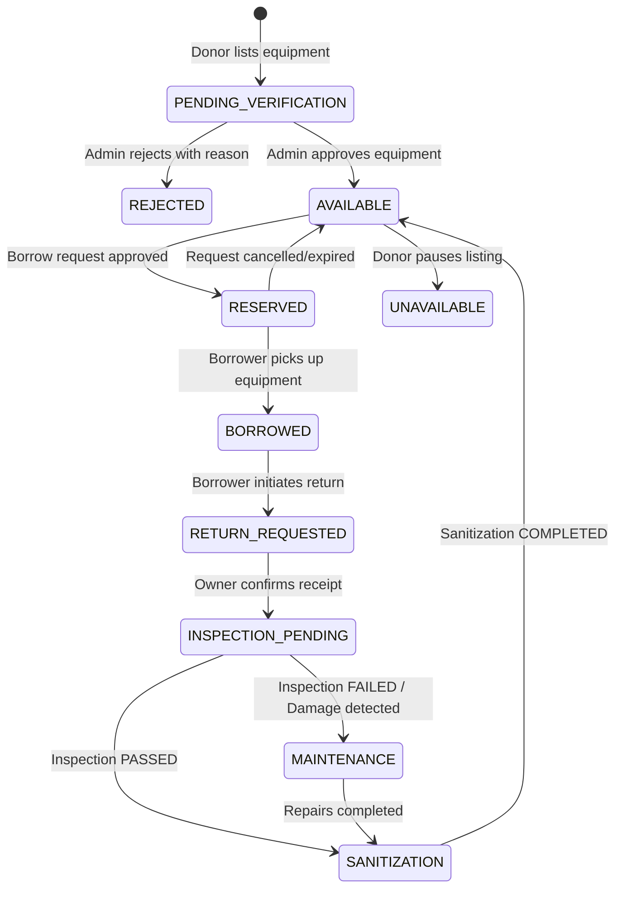

# CARESHARE – ADMIN OPERATIONS & ARCHITECTURE MANUAL

> **“Share Care. Support Recovery.”**  
> Complete Production Technical Guide, Security Specifications, Operational Workflows, and Test Verification for Administrators and Engineering Teams.

---

## 1. Executive Summary

**CareShare – Community Medical Equipment Sharing Bank** is a healthcare-oriented platform engineered to connect community donors who possess medical equipment (such as wheelchairs, hospital beds, walkers, oxygen concentrators, and patient lifts) with patients, caregivers, and families in temporary need of recovery assistance.

Medical equipment is critical for patient dignity and physical rehabilitation, but often sits idle after recovery or is prohibitively expensive to purchase new. CareShare solves this through a verified, peer-to-peer sharing ecosystem anchored by stringent **administrative oversight, safety inspection protocols, and certified sanitization standards**.

---

## 2. Platform Architecture & Separation of Roles

### The Unified User Model (`USER`)
CareShare enforces a unified account model for regular community members:
- **No Artifical Partitioning**: A user registered on CareShare can both **donate** unused medical equipment and **borrow** equipment for their family or patients without needing separate logins or dual profiles.
- **Role Isolation**: The registration endpoint (`POST /api/v1/auth/register`) strictly assigns `role: 'USER'`. The payload schema never allows public signups to elevate themselves to `ADMIN`.

### The Administrator Role (`ADMIN`)
The `ADMIN` account represents platform operators, clinical coordinators, and warehouse managers who oversee:
1. **Equipment Verification**: Reviewing submitted listings, documentation, and condition photos before items appear in the public catalog.
2. **Catalog & Inventory Oversight**: Monitoring equipment availability states (`AVAILABLE`, `RESERVED`, `BORROWED`, `MAINTENANCE`, `SANITIZATION`, `UNAVAILABLE`).
3. **Borrow Request Moderation**: System-wide visibility of all requests across all donors and borrowers.
4. **Returns & Logistics**: Tracking returned equipment from borrowers back to donors or local distribution hubs.
5. **Safety Inspections**: Recording physical checks, component testing, structural safety, and defect tracking.
6. **Disinfection & Sanitization**: Managing medical-grade cleaning protocols prior to returning items into circulation.
7. **User Moderation**: Reviewing member directories, monitoring platform activity, and deactivating abusive accounts while protected by self-lockout safeguards.

---

## 3. Authentication & Security Architecture

CareShare implements enterprise-grade security practices across the entire MERN stack:

| Security Vector | Implementation Detail |
|---|---|
| **Token Transport** | `HTTP-only`, `SameSite: 'strict'` (or `'none'` in cross-site production with HTTPS), `secure: true` in production cookies. |
| **Storage Protection** | **Zero localStorage JWT storage**. The frontend never touches raw JWT strings, eliminating XSS token theft vectors. |
| **API Client** | Axios configured with `withCredentials: true` across all requests to exchange cookies automatically. |
| **Route Protection (Backend)** | Dual middleware: `protect` (verifies JWT from cookie/header and validates active user in DB) + `authorizeRoles('ADMIN')`. |
| **Route Protection (Frontend)** | `AdminRoute` component checks `isAuthenticated`, `loading`, and verifies `user.role === 'ADMIN'`. Unauthorized users are redirected to `/`. |
| **HTTP Security Headers** | `helmet` configured with Cross-Origin Resource Policy and secure referrer policies. |
| **Rate Limiting** | `express-rate-limit` prevents brute-force login/register attacks (100 reqs / 15 mins general, 10 reqs / 15 mins auth). |
| **Input Validation** | Strict `Zod` schemas validate every incoming request body, query parameter, and route parameter. |
| **Idempotency & Lockout Guard** | Built-in server safeguards prevent an admin from deactivating their own logged-in account or the last remaining active administrator in the database. |

---

## 4. Admin Provisioning & Environment Configuration

### Provisioning Strategy
In production environments, administrator accounts must never be exposed through public registration routes. CareShare provides an idempotent administrative CLI seed tool:

```bash
cd backend
npm run seed:admin
```

### Environment Variables
Configure the administrator credentials securely in `backend/.env`:

```env
PORT=5000
NODE_ENV=development
MONGODB_URI=mongodb+srv://<username>:<password>@cluster.mongodb.net/careshare?retryWrites=true&w=majority
JWT_SECRET=super_secret_jwt_key_at_least_32_characters_long
JWT_EXPIRE=7d
JWT_COOKIE_EXPIRE=7

# Admin Provisioning Credentials
ADMIN_NAME=CareShare System Administrator
ADMIN_EMAIL=admin@careshare.org
ADMIN_PASSWORD=AdminSecurePass2026!
ADMIN_PHONE=+1-800-555-0199
ADMIN_CITY=Springfield
ADMIN_STATE=IL
ADMIN_PINCODE=62701
```

### Seed Script Logic (`backend/src/scripts/seedAdmin.js`)
- Reads credentials securely from environment variables.
- Connects to MongoDB Mongoose 8.
- Checks if an admin already exists matching `ADMIN_EMAIL`.
- If missing, creates the user with `role: 'ADMIN'`, `isActive: true`, `isEmailVerified: true`, and hashes the password with `bcryptjs`.
- If already present, safely ensures the account is promoted to `ADMIN` and active without altering historical data or duplicate records.

---

## 5. Admin Panel Feature Specifications & Endpoints

### 5.1 Admin Operations Dashboard (`/admin` or `/admin/dashboard`)
- **Backend API**: `GET /api/v1/admin/stats`
- **MongoDB Aggregation**: Computes all metrics dynamically across real database collections:
  - **User Metrics**: Total members, active members, deactivated members.
  - **Equipment Metrics**: Total catalog, pending verification, approved, rejected, available, reserved, borrowed, in maintenance, in sanitization.
  - **Borrow Metrics**: Total requests, pending approvals, active handovers, completed loans.
  - **Operations Pipeline**: Pending returns, pending inspections, pending sanitizations, damage/repair cases.
  - **Recent Activity**: Real-time log of the latest 5 borrow requests across the entire community with equipment, borrower, owner, status, and dates.

### 5.2 Pending Equipment Verification (`/admin/pending-equipment`)
- **Backend API**: `GET /api/v1/admin/equipment/pending`
- **Actions**:
  - `PATCH /api/v1/admin/equipment/:id/approve` – Approves listing, moves verificationStatus to `APPROVED` and availabilityStatus to `AVAILABLE`. Notifies donor.
  - `PATCH /api/v1/admin/equipment/:id/reject` – Prompts for rejection reason, updates status to `REJECTED`, and dispatches explanatory notification to donor.

### 5.3 System-Wide Inventory Management (`/admin/equipment`)
- **Backend API**: `GET /api/v1/admin/equipment`
- **Filters**: Search query (name/brand/model), category, availability status (`AVAILABLE`, `BORROWED`, `RESERVED`, `MAINTENANCE`, `SANITIZATION`, `UNAVAILABLE`), verification status (`PENDING`, `APPROVED`, `REJECTED`), pagination.
- **Actions**: Detailed view, administrative deletion (`DELETE /api/v1/equipment/:id`).

### 5.4 System-Wide Borrow Requests Oversight (`/admin/borrow-requests`)
- **Backend API**: `GET /api/v1/admin/borrow-requests`
- **Function**: Enables administrators to monitor all borrow requests platform-wide (distinct from individual user received requests).
- **Filters**: Status (`PENDING`, `APPROVED`, `ACTIVE`, `RETURN_REQUESTED`, `COMPLETED`, `REJECTED`, `CANCELLED`), search by equipment, borrower, or owner.
- **Deep-linking**: Quick navigation to detailed borrow view with pickup and return timestamps.

### 5.5 Returns Management (`/admin/returns`)
- **Backend API**: `GET /api/v1/admin/returns`
- **Function**: Tracking return handovers across the community.
- **Filters**: Status (`REQUESTED`, `ITEM_RETURNED`, `INSPECTION_PENDING`, `COMPLETED`, `CANCELLED`).
- **Pipeline Integration**: One-click transition to trigger inspection for items marked `INSPECTION_PENDING`.

### 5.6 Damage Inspection Workflows (`/admin/inspections`)
- **Backend API**:
  - `GET /api/v1/inspections/pending`
  - `GET /api/v1/inspections`
  - `POST /api/v1/inspections`
- **Execution Flow**:
  - Inspector records condition (`EXCELLENT`, `GOOD`, `FAIR`, `POOR`, `DAMAGED`).
  - Sets passed status (`PASSED`, `FAILED`, `REQUIRES_MAINTENANCE`).
  - If `PASSED`: Equipment is automatically transitioned to `SANITIZATION` queue.
  - If `FAILED` / `REQUIRES_MAINTENANCE`: Equipment is moved to `MAINTENANCE` with detailed defect logs and maintenance notes.

### 5.7 Disinfection & Sanitization Pipeline (`/admin/sanitization`)
- **Backend API**:
  - `GET /api/v1/sanitization/pending`
  - `GET /api/v1/sanitization`
  - `POST /api/v1/sanitization`
  - `PATCH /api/v1/sanitization/:id/complete`
- **Execution Flow**:
  - Logs sanitization method (`CHEMICAL_DISINFECTION`, `UV_C_IRRADIATION`, `STEAM_STERILIZATION`, `ALCOHOL_WIPE_DOWN`, `DEEP_CLEANING`).
  - Records batch/facility notes.
  - Upon completion (`completeSanitization`), the equipment status is restored to `AVAILABLE` and ready for the next patient.

### 5.8 User Directory & Moderation (`/admin/users`)
- **Backend API**:
  - `GET /api/v1/admin/users` (supports `search`, `role`, and `status=active|inactive`)
  - `PATCH /api/v1/admin/users/:id/toggle-status`
- **Features**:
  - Aggregates each user's donation count (`equipmentCount`) and borrow count (`borrowCount`).
  - Includes status filter for instant active/inactive segregation.
  - Enforces safety locks: Disallows self-deactivation and preserves the last active administrator.

### 5.9 Operations Audit & Notifications (`/admin/notifications`)
- **Backend API**: `GET /api/v1/notifications`, `PATCH /api/v1/notifications/:id/read`, `PATCH /api/v1/notifications/read-all`
- **Function**: Comprehensive audit trail of system events, verification decisions, and operational handovers.

### 5.10 Admin Profile & Security (`/admin/profile`)
- **Backend API**: `GET /api/v1/users/profile`, `PATCH /api/v1/users/change-password`
- **Function**: View administrative credentials, operational base, security credentials, and update admin password with min 8-character validation.

---

## 6. End-to-End Equipment Lifecycle State Machine



---

## 7. Role-Based Access Control (RBAC) Matrix

| Route / Capability | Visitor / Public | Registered User (Donor / Borrower) | Administrator (`ADMIN`) |
|---|:---:|:---:|:---:|
| Browse Approved Equipment (`/equipment`) | Yes | Yes | Yes |
| View Equipment Details (`/equipment/:id`) | Yes | Yes | Yes |
| Register / Login (`/login`, `/register`) | Yes | Yes | Yes |
| List Unused Equipment (`/add-equipment`) | No | Yes | Yes |
| Edit Own Equipment (`/my-equipment/:id/edit`) | No | Yes (Owner only) | Yes (Admin bypass) |
| Request to Borrow Equipment | No | Yes (Non-owner only) | Yes |
| Approve / Reject Borrow Request | No | Yes (Owner only) | Yes |
| Confirm Return Receipt | No | Yes (Owner only) | Yes |
| Admin Dashboard Overview (`/admin`) | No | No (403 Forbidden) | Yes |
| Approve / Reject Listed Equipment | No | No (403 Forbidden) | Yes |
| Conduct Safety Inspections (`/admin/inspections`) | No | No (403 Forbidden) | Yes |
| Complete Sanitization (`/admin/sanitization`) | No | No (403 Forbidden) | Yes |
| Moderate User Directory (`/admin/users`) | No | No (403 Forbidden) | Yes |
| System-Wide Returns Oversight (`/admin/returns`) | No | No (403 Forbidden) | Yes |

---

## 8. Verification & Test Execution Results

The backend includes a comprehensive 17-step end-to-end integration test suite (`backend/test-suite.js`) executing against live MongoDB Atlas:

```bash
cd backend
npm test
```

### Test Execution Matrix
| Step | Workflow Stage | Validation Target | Status |
|---|---|---|:---:|
| 1 | User Registration | Donor & Borrower registered (`role: 'USER'`), Admin verified (`role: 'ADMIN'`) | Passed |
| 2 | Login & Authentication | JWT generated, HTTP-only cookie issued, password exclusion | Passed |
| 3 | Forgot & Reset Password | Cryptographic reset token generated, password hashed, re-auth verified | Passed |
| 4 | User Profile Management | User contact and location coordinates updated | Passed |
| 5 | Equipment Creation | Equipment created with `PENDING` verification and `UNAVAILABLE` availability | Passed |
| 6 | Admin Verification | Admin inspects queue, approves listing -> `APPROVED` & `AVAILABLE` | Passed |
| 7 | Equipment Discovery | Search by keyword, category, condition with active status filters | Passed |
| 8 | Self-Borrow Prevention | Attempt to borrow own equipment rejected with 400 Bad Request | Passed |
| 9 | Borrow Request Submission | Borrower requests item -> status `PENDING` | Passed |
| 10 | Overlapping Protection | Request approved -> status `RESERVED`; concurrent request blocked | Passed |
| 11 | Equipment Pickup | Borrower picks up -> Request: `ACTIVE`, Equipment: `BORROWED` | Passed |
| 12 | Return Initiation | Borrower submits return -> status `REQUESTED` | Passed |
| 13 | Owner Return Receipt | Owner confirms receipt -> Return: `INSPECTION_PENDING`, Borrow: `COMPLETED` | Passed |
| 14 | Safety Inspection | Inspection recorded as `PASSED` -> Equipment moves to `SANITIZATION` | Passed |
| 15 | Disinfection Protocol | Sanitization logged as `IN_PROGRESS` -> completed -> status restored to `AVAILABLE` | Passed |
| 16 | Notification Dispatch | Push notifications verified across donor and borrower mailboxes | Passed |
| 17 | Admin Dynamic Statistics | 17 real MongoDB aggregation metrics computed with zero mock data | Passed |

**Result: 17 of 17 tests passed (100% success rate).**

---

## 9. Frontend Production Build Verification

The React frontend has been compiled and bundled using Vite:

```bash
cd frontend
npm run build
```

- **Modules Transformed**: 1,680
- **Bundle Output**:
  - `dist/index.html` (0.99 kB)
  - `dist/assets/index-*.css` (43.57 kB)
  - `dist/assets/index-*.js` (463.56 kB)
- **Zero build errors or unresolved dependencies.**

---

## 10. Local Development & Deployment Guide

### Prerequisites
- Node.js 18+ (tested on Node v22.12.0)
- MongoDB 6.0+ or MongoDB Atlas connection URI

### 1. Backend Setup
```bash
cd backend
npm install
cp .env.example .env
# Update MONGODB_URI and JWT_SECRET in .env
npm run seed:admin   # Provisions default admin account
npm run dev          # Starts Express server on http://localhost:5000
```

### 2. Frontend Setup
```bash
cd frontend
npm install
npm run dev          # Starts Vite dev server on http://localhost:5173
```

### 3. Log In to Admin Console
- Navigate to `http://localhost:5173/login`
- Enter the admin credentials (e.g. `admin@careshare.org` / `AdminSecurePass2026!`)
- Click **Admin Panel** in the navigation header or access `http://localhost:5173/admin` directly.
